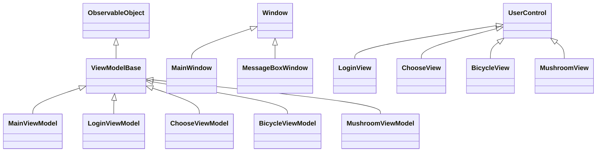
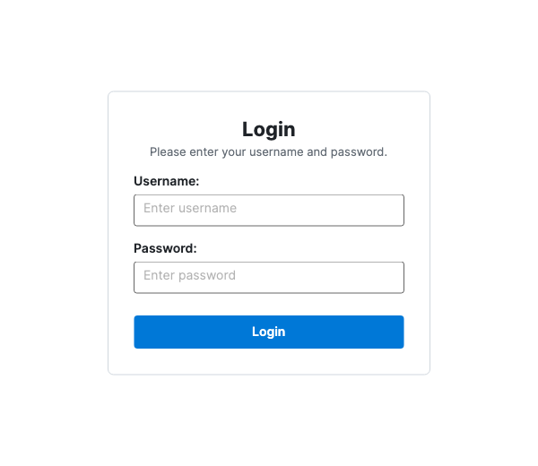
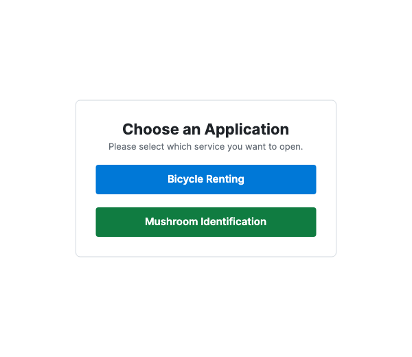
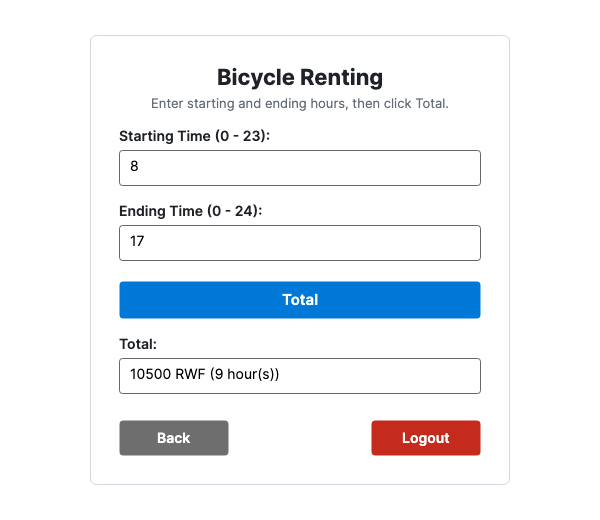
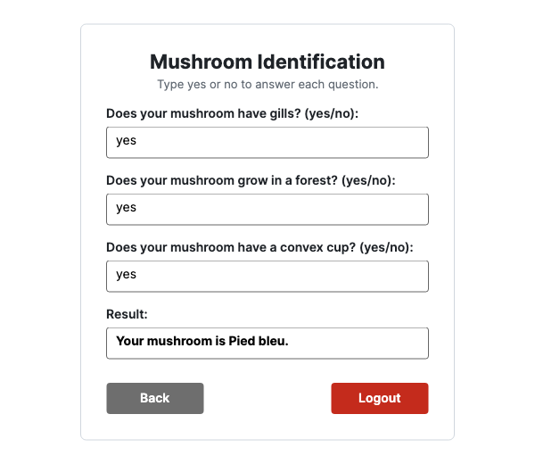

# LAB 2 - Desktop Application (C# / .NET 8)

> **C# (.NET) Assignment - Transition from Console Application to Desktop Application**

---

## 📌 Project Overview & Note on Avalonia UI

This project is the desktop implementation of **Lab 1** (Bicycle Rental and Mushroom Identification), built using **.NET 8** and **Avalonia UI**.

### Why Avalonia UI instead of Microsoft Windows Forms?
* **Cross-Platform Compatibility:** Microsoft Windows Forms (`System.Windows.Forms`) is exclusively supported on Windows operating systems and **cannot run on macOS or Linux**.
* **Modern Desktop Standard:** **Avalonia UI** is the modern, open-source cross-platform UI framework for C# and .NET.
* **Same Core Concepts:** Although Avalonia was used to allow development and execution on macOS, it follows the exact same fundamentals and principles required by the assignment:
  * **Controls:** `TextBox` for input, `Button` for actions, `Label` (`TextBlock`) for instructions, and modal `MessageBox` popups for notifications.
  * **Event & Data Flow:** Input validation, conditional logic, and calculations behave identically to Windows Forms.
  * **Interface Navigation:** Switching between views (Login $\rightarrow$ Choose $\rightarrow$ Bicycle / Mushroom) functions as moving between forms.

---

## 🏛️ Object-Oriented Programming & Inheritance

The project leverages C# Object-Oriented Programming (OOP) and **Inheritance**:



### 1. ViewModel Inheritance Hierarchy
* **`ViewModelBase`** inherits from `CommunityToolkit.Mvvm.ComponentModel.ObservableObject`, providing change notification (`INotifyPropertyChanged`) to all derived classes.
* **Child ViewModels:** `LoginViewModel`, `ChooseViewModel`, `BicycleViewModel`, and `MushroomViewModel` all inherit from `ViewModelBase`.
* **Polymorphic Navigation:** `MainViewModel` maintains a single property:
  ```csharp
  [ObservableProperty]
  private ViewModelBase _currentView;
  ```
  Because of polymorphism, any child view model can be assigned to `CurrentView`, allowing seamless screen transitions.

### 2. View Inheritance Hierarchy
* **`MainWindow`** and **`MessageBoxWindow`** inherit from Avalonia's `Window` class.
* **`LoginView`**, **`ChooseView`**, **`BicycleView`**, and **`MushroomView`** inherit from `UserControl`, modularizing each screen like a separate Windows Form.

---

## 🖼️ Application Screenshots

### 1. Login Screen
* Requires both Username and Password (validated to ensure they are not empty).
* Displays a `MessageBox` if submitted with empty fields.
* On successful login, transitions to the **Choose** screen.



---

### 2. Choose Screen
* Navigation hub providing two options:
  * **Bicycle Renting**
  * **Mushroom Identification**



---

### 3. Bicycle Rental Screen
* Inputs for **Starting Time (0–23)** and **Ending Time (0–24)**.
* Handles daytime and overnight rentals (`endTime <= startTime`).
* Computes tiered hourly rates:
  * 00:00 – 06:59: **500 RWF / hr**
  * 07:00 – 13:59: **1,000 RWF / hr**
  * 14:00 – 18:59: **1,500 RWF / hr**
  * 19:00 – 20:59: **1,000 RWF / hr**
  * 21:00 – 23:59: **500 RWF / hr**
* Clicking the **`Total`** button validates inputs, outputs the result to the `Total:` box, and displays a summary in a `MessageBox`.
* Navigation buttons: **`Back`** (returns to Choose) and **`Logout`** (returns to Login).



---

### 4. Mushroom Identification Screen
* Implements the exact decision tree logic from Lab 1.
* **Interactive Dynamic Flow:** Questions appear sequentially with their own input boxes as the user answers `yes` or `no`:
  1. *Does your mushroom have gills?*
  2. *Does your mushroom grow in a forest?* (appears if Question 1 is `yes`)
  3. *Does your mushroom have a ring?* or *Does your mushroom have a convex cup?* (appears based on Question 2)
* Automatic validation displays `Invalid answer!` in a `MessageBox` if the user enters anything other than `yes` or `no`.
* Identifies species: *Cèpe de Bordeaux*, *Agaric Jaunissant*, *Coprin chevelu*, *Pied bleu*, or *Girolle*.
* Shows the result in the `Result:` box and pops up a `MessageBox`.
* Navigation buttons: **`Back`** and **`Logout`**.



---

## 🚀 How to Build and Run

### Prerequisites
* [.NET 8.0 SDK](https://dotnet.microsoft.com/download/dotnet/8.0)

### Run the Application
Open your terminal in the project directory and run:

```bash
dotnet run --project LAB2
```
